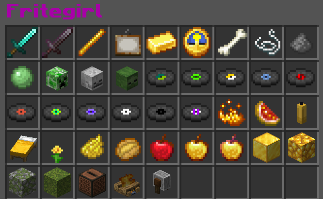
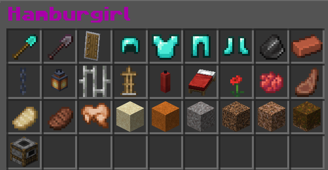
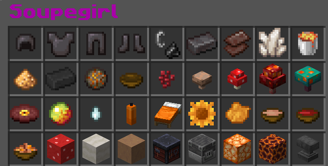
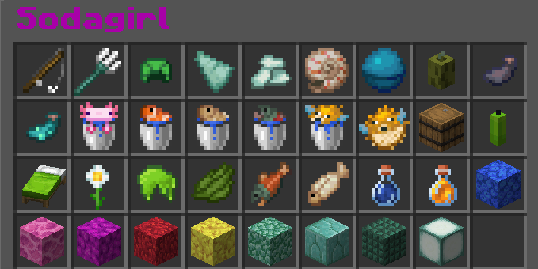
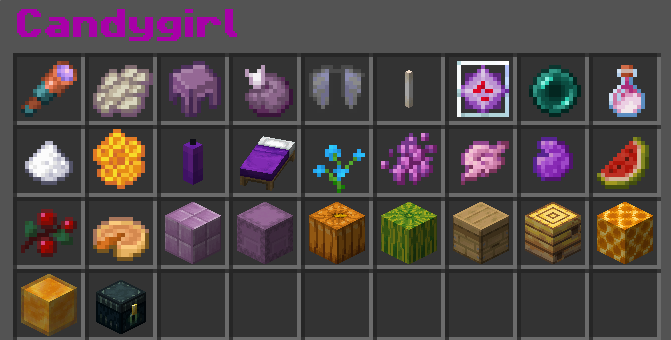
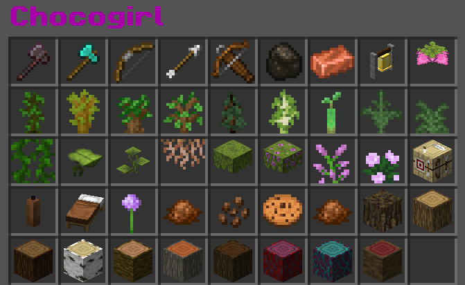
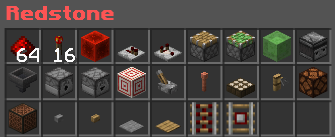

## La boutique
Le serveur propose aux joueurs un système de shop afin de pouvoir vendre facilement et rapidement leurs divers butins lors de l'exploration des mondes ressources.
Les boutiques permettent également d'acheter certains items, mais tous les items ne sont pas disponibles.
Les boutiques ne sont pas organisées par fonction, mais par affinité avec les divinités. La commande de vente en masse utilise toutes les boutiques, donc la vente reste facile et intuitive.
### Prix
Les valeurs de vente et d'achat sont déterminés en fonction de l'abondance, la génération naturelle, la capacité à être farm, le facteur chance, l'utilité … 
Les prix des objets composés sont déterminés en fonction des objets utilisés dans la recette de craft, et l'éventuelle complexité (facteur temps).
Le prix d'achat est généralement 4x le prix de vente pour un objet, afin d'encourager les joueurs à chercher les ressources plutôt que les acheter.
Il est possible de vérifier tous les prix dans la boutique en jeu.
- Lingot d'or = 8 émeraudes
- Diamant = 16 émeraudes
- Lingot de fer = 4 émeraudes
- Lapis = 1 émeraude
- Redstone = 10 émeraudes par stack
- Buches = 3 émeraudes pour 10
### Les boutiques
Il y a dix boutiques : une par divinité (Nuggetsgirl, Fritegirl, Hamburgirl, Soupegirl, Sodagirl, Candygirl, Flurrygirl, Chocogirl, Fringirl) et une boutique Redstone. La liste des objets et des prix de chacune est dans la section [Boutiques](/boutiques/).

### Images des boutiques

*Contenu de la boutique Nuggetsgirl*

*Contenu de la boutique Fritegirl*

*Contenu de la boutique Hamburgirl*

*Contenu de la boutique Soupegirl*

*Contenu de la boutique Sodagirl*

*Contenu de la boutique Candygirl*

*Contenu de la boutique Flurrygirl*

*Contenu de la boutique Fringirl*

*Contenu de la boutique Chocogirl*

*Contenu de la boutique Redstone*
