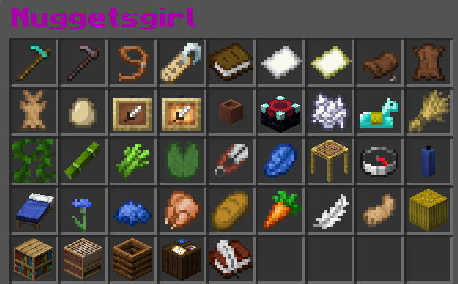
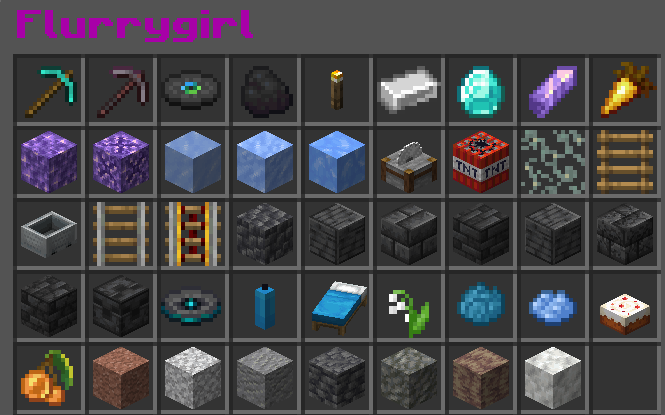
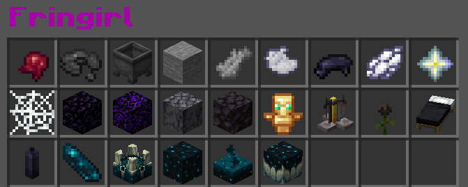

## La boutique
Le serveur propose aux joueurs un système de shop afin de pouvoir vendre facilement et rapidement leurs divers butins lors de l'exploration des mondes ressources.
Les boutiques permettent également d'acheter certains items, mais tous les items ne sont pas disponibles.
Les boutiques ne sont pas organisées par fonction, mais par affinité avec les divinités. La commande de vente en masse utilise toutes les boutiques, donc la vente reste facile et intuitive.
### Prix
Les valeurs de vente et d'achat sont déterminés en fonction de l'abondance, la génération naturelle, la capacité à être farm, le facteur chance, l'utilité … 
Les prix des objets composés sont déterminés en fonction des objets utilisés dans la recette de craft, et l'éventuelle complexité (facteur temps).
Le prix d'achat est généralement 4x le prix de vente pour un objet, afin d'encourager les joueurs à chercher les ressources plutôt que les acheter.
Il est possible de vérifier tous les prix dans la boutique en jeu.
- Lingot d'or = 8 émeraudes
- Diamant = 16 émeraudes
- Lingot de fer = 4 émeraudes
- Lapis = 1 émeraude
- Redstone = 10 émeraudes par stack
- Buches = 3 émeraudes pour 10
### Boutique de Nuggetsgirl
La boutique contient des outils de culture, des produits animaux, 
- Pain
- Carrote
- Lapis
- Oeuf
- Poulet cuit
- Cane à sucre
- Bambou
- Blé
- Plume
- Engrais
- Laisse
- Tag
- Cuir
- Houe
### Boutique de Fritegirl
La boutique contient des butins d'exploration et de monstres, ainsi que des objets en or.
- Lingot d'or
- Pomme de terre cuite
- Pomme
- Baton de blaze
- Os
- Corde
- Poudre à canon
- Boule de slime
- Têtes de mob
- Disques
- Pomme en or
- Pomme en or enchantée
- Mousse
- Epées
### Boutique de Hamburgirl
La boutique contient de l'équipement de protection, des viandes, ainsi que des matériaux de construction et du terrain.
- Armure en diamant
- Bouclier
- Sylex
- Briques
- Lanterne
- Barrière en fer
- Steak
- Cotelette
- Mouton cuit
- Porte-armure
- Sable, sable rouge, gravier, podzol, terre stérile
- Pelles
### Boutique de Soupegirl
La boutique contient des objets en provenance du Nether.
- Netherite
- Quartz
- Seau de lave
- Glowstone
- Brique du Nether
- Boule de feu
- Verrue du Nether
- Champignon rouge et brun
- Champignons du Nether
- Larme de Ghast
- Ragout de lapin
- Bloc de magma
- Champilampe
- Blocs de champignon
### Boutique de Sodagirl
La boutique contient des objets en provenance de l'océan (poissons, coraux, algues, prismarin) et de l'équipement de pêche.
- Cane à pêche
- Trident
- Carapace de tortue
- Cristaux et éclats de prismarin
- Coquille de nautile
- Cornichon de mer
- Poche d'encre
- Poissons en seau
- Morue cuite
- Saumon cuit
- Fiole d'eau
- Fiole de miel
- Bloc de coraux
- Bloc de prismarin
- Lanterne aquatique
### Boutique de Candygirl
La boutique contient des objets en provenance de l'End, ainsi que de la nourriture sucrée.
- Chorus
- Barre de l'End
- Elytres
- Boite de Shulker
- Membrane de Phantom
- Perle de l'End
- Souffle de dragon
- Sucre
- Rayon de miel
- Tranche de pastèque
- Baies sucrées
- Tarte à la citrouille
- Citrouille
- Pastèque
- Ruche
- Nid d'abeille
- Coffre de l'End
- Longue-vue
### Boutique de Flurrygirl
La boutique contient des minerais, des pierres, et de l'équipement pratique pour l'exploration souterraine.
- Pioches
- Torches
- Echelles
- TNT
- Rails
- Chariot
- Baies lumineuses
- Carotte dorée
- Gateau
- Charbon
- Lingot de fer
- Diamant
- Améthyste
- Blocs de glace
- Blocs d'améthyste
- Pierres de abimes
- Granites, diorite, andésite
### Boutique de Chocogirl
La boutique contient des objets en lien avec les arbres et la jungle, ainsi que de l'équipement pour chasseurs.
- Haches
- Arc
- Flèches
- Arbalète
- Lingot de cuivre
- Cookie
- Buches
- Pousses
### Boutique de Fringirl
La boutique contient des objets obscurs, d'origine surnaturelle, ou qui ne représente pas les autres divinités.
- Oeil d'araignée fermenté
- Etoile du Nether
- Toile d'araignée
- Obsidienne
- Basalte, roche, roche noire
- Totem d'immortalité
- Alambic
- Eclat d'écho
- Sculk
### Boutique Redstone
Contient tous les objets permettant la construction de circuits en redstone.
- Stack de redstone
- Torches redstone
- Répéteur, comparateur
- Piston, piston collant, bloc de slime
- Distributeur, dropper
- Boutons, leviers, plaques de pression
- Lampe à redstone
- Bloc musical
### Images des boutiques

*Contenu de la boutique Nuggetsgirl*

*Contenu de la boutique Fritegirl*

*Contenu de la boutique Hamburgirl*

*Contenu de la boutique Soupegirl*

*Contenu de la boutique Sodagirl*

*Contenu de la boutique Candygirl*

*Contenu de la boutique Flurrygirl*

*Contenu de la boutique Fringirl*

*Contenu de la boutique Chocogirl*

*Contenu de la boutique Redstone*
